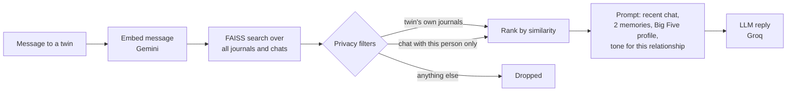

# AI Messenger: a family messenger with an AI twin

A messenger for families with an **AI twin mode**. When someone is busy, their twin replies in their place, in their own tone, using what they have written in private journals and said in past chats. The twin has to recall the right memory, and it must never reveal one person's private journal or chat to someone else.

**Live demo:** https://ai-twin-fastapi.onrender.com (free hosting, so the first load can take about a minute)


## Try it

The demo family shares the password `password`. **Nipa** has AI mode on.

| Log in as | Ask Nipa's twin | It should use |
|---|---|---|
| `nick` (brother) | "Are you free next Saturday?" | her journal: football final at 4 pm |
| `arif` (father) | "Do you like hiking?" | her journal: the Sajek trip |
| `diana` (mother) | "What food do you hate?" | her journal: karela |

You can also sign up, set a relationship with a demo user, and turn on your own AI mode.

## How a reply is built



- **Memory:** journals and messages are embedded with Gemini (`gemini-embedding-001`) and searched with FAISS.
- **Privacy filters:**
  - a twin sees only its owner's private journals;
  - it sees only the messages from its chat with the person it is talking to, so something said to one family member is never repeated to another.
- **Ranking:**
  - memories are ranked by cosine similarity;
  - messages already visible in the chat are skipped;
  - the best-matching journal gets one of the two places in the prompt, because the prompt treats journals as the owner's private truth.
- **Persona:**
  - a Big Five personality profile, generated by an LLM from the owner's journals and messages and cached for 24 hours;
  - a tone that depends on the relationship (sibling, parent, partner).
- **Stack:** FastAPI with WebSockets, MongoDB (Motor), FAISS, LangChain, Gemini embeddings, Groq-hosted LLM (`gpt-oss-20b`), spaCy/NLTK, deployed on Render.

## Evaluation

The retrieval is measured on a synthetic benchmark in [`eval/`](eval/README.md): a fictional family with 56 journal entries and 35 messages, 60 labelled questions, 20 privacy probes, and 10 inputs that should recall nothing. An offline copy of the pipeline allows ablations, and [`eval/check_app.py`](eval/check_app.py) confirms that the code in `app.py` gives the same numbers.

| | Before | After |
|---|---|---|
| Right memory ranked first | 33% | 87% |
| Right memory among the two the prompt uses | 53% | 98% |
| Other people's private journals retrieved (20 probes) | 0 | 0 |
| Messages from other chats shown to the person asking | possible | blocked |
| Reply time on the live server | ~40 s | ~6 s |

These numbers come from a local embedding model (`bge-small-en-v1.5`) on a small synthetic benchmark, not from the live Gemini setup. The reply times were measured on the live server.

What the evaluation and the live tests found:

1. **Recency beat relevance.** A +1.0 bonus for the owner's journals plus a strong recency multiplier outweighed similarity, so the newest journals won almost regardless of the question. Ranking is now by similarity, with small tie-breakers.
2. **Cross-chat leak.** A twin could repeat its own messages from other chats. In the benchmark, the father asks about his son's job offer and the twin retrieves the daughter's message to her brother, "Tell me first before you tell Abbu". Twins now recall messages only from the chat with the person asking.
3. **Random retrieval.** Synonym expansion iterated over Python sets, so results changed with every server restart (Hit@3 60–68%). It is removed.
4. **Wasted prompt slots** (found in live testing). Both memory places in the prompt went to messages already visible in the chat, so the journal saying "busy on Saturday" never reached the model. Visible messages are now skipped, and journals get a place.
5. **40-second replies** (found with per-step timing logs). The embedding and LLM calls took about 1 second. The rest went to re-creating 12 MongoDB indexes at nearly every step. Indexes are now created once.

Details, ablations and caveats are in [`eval/README.md`](eval/README.md).

## Run locally

Create a `.env` file with the variables below, then:

```bash
pip install -r requirements.txt
uvicorn app:app --reload
```

| Variable | Purpose |
|---|---|
| `MONGODB_URI` | MongoDB connection string |
| `GEMINI_API_KEY` | embeddings |
| `GROQ_API_KEY` | chat and personality LLM |
| `SEED_DEMO` | `true` to create the demo family on start |
| `MEMORY_MIN_SIM` | optional similarity cut-off for memories (default 0 = off; calibrate with `eval/` first) |

Run the evaluation with `python -m eval.run_eval` (local model, no API key needed).

## Limitations

- The benchmark is synthetic and small, and the retrieval changes were designed after seeing its results. A fresh, independently written question set would be a fairer test.
- The Big Five profile is an LLM estimate from about 4,000 characters of text. Its validity has not been tested.
- Free hosting: the server sleeps after 15 minutes without visitors.
